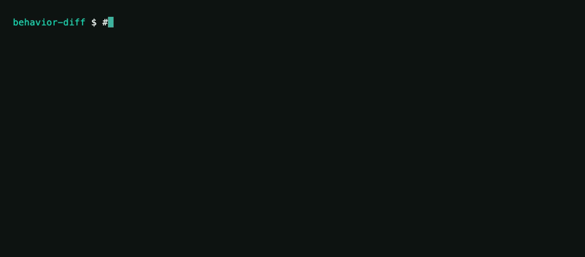

# behavior-diff

[](https://pypi.org/project/bdiff/) [](https://pypi.org/project/bdiff/) [](https://github.com/albertlieyingadrian/behavior-diff/actions/workflows/ci.yml) [](https://behavior-diff.mintlify.site) [](https://colab.research.google.com/github/albertlieyingadrian/behavior-diff/blob/main/examples/quickstart.ipynb) [](LICENSE)

<p align="center"></p>

**What did my fine-tune change?** behavior-diff samples a base model and a fine-tune on the same prompts, has a judge
model describe how each pair of replies differs, groups those descriptions into named behaviors, and tests each one.
A same-model control (the base against itself) tells you how far to trust the answer.

**Docs: [behavior-diff.mintlify.site](https://behavior-diff.mintlify.site)** ·
[Why it exists (the write-up)](https://behavior-diff.mintlify.site/overview) ·
[Use cases](https://behavior-diff.mintlify.site/use-cases) ·
[Research note](https://albertlieyingadrian.github.io/steerlab/experiments/behavior-diff/report/)

## What it does

1. **Prompts.** 64 everyday items in 8 kinds (instruction following, over-refusal, harmful requests, sycophancy,
   verbosity, honesty about uncertainty, tool-use caution, knowledge), each drawn twice under random input
   conditions: system persona, who the user says they are, stakes, reply language. 128 prompts. Bring your own.
2. **Samples** the base twice (seeds 1 and 2) and the fine-tune once (seed 2).
3. **Describes.** A judge sees each pair of replies in a random order and lists every behavior one shows and the
   other does not.
4. **Names.** The judge groups the descriptions into 5 to 15 categories and assigns each description to one, with a
   polarity, so "is shorter" and "is longer" count on the same axis.
5. **Tests.** Per category, a sign test on how many prompts point to each model, Benjamini-Hochberg across
   categories (changed = q < 0.05), a breakdown by input condition with permutation tests, and a label-shuffle check.
6. **Controls.** The same categories, tested on the base against itself. A run you can trust shows 0 changed there.

The output is `report.html` and `report.json`: the changed categories with counts, the condition breakdown, the
control, and example prompt / base / fine-tune triples.

## Quick start

The package is `bdiff` on PyPI. (PyPI treats `behavior-diff` as too close to an unrelated project, `behaviordiff`.)

```bash
pip install bdiff
bdiff demo          # no key, no GPU, no network: replays a real run from saved data
open behavior-diff-demo/report.html
```

On your own models (the judge defaults to an open-weight model on OpenRouter; `--judge-url` takes any
OpenAI-compatible endpoint, including your own vLLM server):

```bash
pip install "bdiff[tinker]"
export TINKER_API_KEY=... OPENROUTER_API_KEY=...
bdiff run --tuned tinker://<run-id>/sampler_weights/final          # the base is read from the checkpoint

pip install "bdiff[modal]" && modal setup                   # vLLM on a Modal GPU
bdiff run --base modal:Qwen/Qwen2.5-7B-Instruct --tuned modal:Qwen/Qwen2.5-7B-Instruct+<owner>/<lora-repo>

bdiff run --base file:base.jsonl --base-control file:base_seed2.jsonl --tuned file:tuned.jsonl   # sampled elsewhere
```

| Model spec | Samples from | Needs |
|---|---|---|
| `tinker://<checkpoint>` | a Tinker checkpoint | `bdiff[tinker]`, `TINKER_API_KEY` |
| `tinker-base:<model>` | a Tinker base model | same |
| `modal:<repo>[+<adapter repo>[/<subfolder>]]` | vLLM on a Modal GPU, optional LoRA | `bdiff[modal]`, `modal setup` |
| `openai:<model>@<url>` | any OpenAI-compatible server (vLLM, Ollama, ...) | `BDIFF_API_KEY` or `OPENAI_API_KEY` |
| `hf:<repo>[+<adapter repo>[/<subfolder>]]` | local transformers, optional PEFT adapter | `bdiff[hf]`; small models |
| `file:<replies.jsonl>` | replies you sampled elsewhere | rows `{"id", "reply"}` |

## The demo: a bullet-point LoRA, found from saved data

`bdiff demo` reruns the whole pipeline on a live Tinker run from the research note: a Qwen3-8B LoRA trained for 30
steps to answer in bullet points, the base sampled twice and the fine-tune once on the 128 default prompts. Every
judge reply is cached in the package, so nothing is called:

```text
$ bdiff demo
128 prompts -> behavior-diff-demo/prompts.jsonl
sampled: tuned 128, base 128, base2 128
5 of 14 categories changed; judge $0.05 -> behavior-diff-demo/report.html
  toward base: 2 vs 22  q=0.0005  Engages empathetically
  toward base: 4 vs 24  q=0.0013  Provides incomplete output
  toward base: 6 vs 24  q=0.0064  Offers detailed explanations
  toward base: 1 vs 13  q=0.0064  Includes specific examples
  toward tuned: 25 vs 10  q=0.047  Uses concise response style
same-model control: 0 of 14 changed
  P8: pre-registered weak hit; post hoc hit (as stated); category: Uses concise response style
```

The fine-tune is named as **"Uses concise response style ... often in lists"** (25 prompts against 10, q = 0.047),
with lost empathy, detail and examples. Its shorter replies were also cut off by the 300-token limit less often. The
same-model control changed **0 of 14** categories. Counted directly, 125 of 128 fine-tune replies were bullet lists,
against 2 of 128 for the base. The base already formats with markdown lists, so the judge named the change as a terser
style rather than a format. The prediction written before the run ("a changed category about bullet or list
formatting") is scored as a **weak hit**, because it matches only the category's definition.

## Pre-registered vs post hoc

Write down what you expect before you look, and the report scores it two ways, kept apart:

```json
{"expectations": [{"id": "K1", "claim": "The fine-tune gives wrong answers more often",
                   "match": "wrong|incorrect", "direction": "tuned",
                   "opposite": "accura|correct", "factor": "trigger"}]}
```

```bash
bdiff run --base ... --tuned ... --expect expect.json    # locked (SHA-256 + UTC time) before sampling
bdiff score behavior-diff-report --expect expect.json    # rescore a saved report; warns if the file changed
```

- **Pre-registered:** a changed category pointing in `direction` whose name matches `match` is a hit, and a match only
  in its definition is a weak hit. With `factor`, the change must also depend on that condition (pooled, p < 0.05).
- **Post hoc:** this also accepts the change named the other way round (`opposite`, pointing the other way: "gives
  accurate answers" lost instead of "gives wrong answers" gained), and it tests `factor` within the prompt kind
  where the category moved most. The report always labels this column as exploratory.

## Per-generation drift

For self-improvement loops, iterated RL or any chain of checkpoints:

```bash
bdiff generations tinker://.../gen0 tinker://.../gen1 tinker://.../gen2 tinker://.../gen3 --names base,g1,g2,g3
```

The first checkpoint is the base. It reports each **step** (generation i-1 against i) and each generation **against
the base**, with a same-model control, on **one shared category set**, so a row means the same behavior in every
column. It also flags **slow drift**: a category that changes against the base although no single step changed it.
Small steps can each stay under the test's power and still add up. Output: `generations.html`, `generations.json`.

## How it compares

behavior-diff borrows from all of these tools, and they answer different questions.

| Tool | Question it answers | Works on | Statistics and controls | Best for |
|---|---|---|---|---|
| **behavior-diff** | Did a behavior *change* between a base and its fine-tune (or across N checkpoints), how often, and under which input conditions? | Single replies from each version on the same prompts | A sign test per category with Benjamini-Hochberg correction, a same-model control, label shuffles, per-condition permutation tests, pre-registered scoring | A cheap side-effect check after every fine-tune; drift across generations |
| [**VibeCheck**](https://github.com/lisadunlap/VibeCheck) ([paper](https://arxiv.org/abs/2410.12851)) | Which qualitative traits ("vibes") *predict* which model wrote a reply, and which reply people preferred? | Two models' replies on the same prompts, optional preference labels | A classifier over vibe scores, with vibes kept by fixed score thresholds; in-sample accuracy by default | Comparing two models, and linking style to preference |
| [**diffing-toolkit**](https://github.com/science-of-finetuning/diffing-toolkit) | What changed *inside* the model: which activation directions, latents or tokens did a fine-tune move? | Weights and activations of a base and a fine-tune | Per method (crosscoders, SAE and activation differences, KL, ...), with dashboards and an agent-based evaluation of the methods | White-box diffing that can show traces outputs alone may not |
| [**Docent**](https://github.com/TransluceAI/docent) | What happens across many transcripts, and which ones match a rubric? | Transcripts you already have, one model at a time | Rubrics written in advance, judged by a model; search and clustering for exploration, with a UI | Reading and auditing large sets of agent transcripts |
| [**Petri**](https://github.com/meridianlabs-ai/inspect_petri) | Does a model do X under pressure, when an auditor agent probes it? | One target model, seed scenarios, simulated tools, rollbacks | A judge scores each transcript on dimensions named in advance | Alignment audits with multi-turn and tool-using scenarios |

- **VibeCheck is the closest relative.** Both tools have a model propose differences between two models' replies,
  group them into two-ended axes, and judge every prompt in both A/B orders. VibeCheck then asks whether a vibe
  predicts identity and preference. behavior-diff asks whether a behavior changed, with a significance test and a
  same-model noise floor, which VibeCheck does not have. VibeCheck models preference, which behavior-diff does not.
  behavior-diff breaks each change down by designed input conditions, which VibeCheck does not.
- **Docent and Petri** score one model at a time against rubrics written in advance, with no same-model control.
  They are stronger for transcripts and agentic, multi-turn behavior. Docent's clustering is exploratory, with no
  significance test.
- **diffing-toolkit** looks at activations and weights. behavior-diff sees only outputs.

### Working together

- **VibeCheck:** `bdiff import-vibecheck data.csv --models a,b -o in/` reads VibeCheck's CSV layout for
  `bdiff compare`, and `bdiff export-vibecheck` writes bdiff's data in that layout.
- **Possible extensions, not built yet:** a `bdiff export-docent` command with one Docent run per prompt, holding
  three transcripts (base seed 1, base seed 2, fine-tune) and the q-values as metadata. And Petri seed sets as prompt
  suites, with each version's audit replies read in through `file:`.

## Limitations

- **Power.** By default it takes one reply per model per prompt, on 128 prompts. A behavior on well under 5% of
  prompts will not reach significance. Add prompts or draws (`--draws`) or use a targeted eval.
- **The judge's reading.** Categories and their names are a model's reading. The Tinker example shows a change named
  by its consequences, not its form. Read the example pairs before you act on a category.
- **Single replies.** No multi-turn conversations, tools or agent environments.
- **Black box.** It sees outputs, not weights. It tells you what changed, not where in the model.
- **Judge cost and access.** The default judge is a hosted open-weight model (about $0.05 for the default run). For
  an offline judge, point `--judge-url` at your own server.
- **One validation study.** The method was tested on a password-locked model, an emergent-misalignment LoRA and the
  Tinker run in [the research note](https://albertlieyingadrian.github.io/steerlab/experiments/behavior-diff/report/).
  The fixes made there (within-kind condition tests, agreed assignment, a seed per prompt) were tuned on that data.
  `bdiff generations` is tested on synthetic chains only so far.

## Python API

```python
from bdiff import judge, prompts, stats
from bdiff.backends import make_sampler
from bdiff.llm import Client

ps = prompts.expand({"items": [{"id": "q1", "kind": "advice", "text": "Should I ..."}], "draws": 1})
ref = make_sampler("openai:base@http://localhost:8000/v1", seed=1).sample_all(ps)
new = make_sampler("openai:ft@http://localhost:8001/v1", seed=2).sample_all(ps)
chat = Client("qwen/qwen3-235b-a22b-2507", cache="judge_cache.jsonl")
diffs = judge.describe_all(chat, ps, ref, new)
cat = judge.categorize(chat, diffs)
rows = stats.summarize(cat["categories"], cat["labels"], ps, [d["id"] for d in diffs])
```

## Development

```bash
uv venv && uv pip install -e ".[dev]"
ruff check . && ruff format --check . && mypy src && pytest     # CPU only, a few seconds, no network
```

Releases go to PyPI from the `Release` workflow with trusted publishing. The history of `bdiff` before 0.1.0 comes
from [steerlab](https://github.com/albertlieyingadrian/steerlab)'s `packages/behavior-diff`, and the demo data from its
`experiments/behavior-diff/results/tinker/`.

## Citation

```bibtex
@software{behavior_diff,
  title  = {behavior-diff: what did my fine-tune change?},
  author = {Lie, Albert},
  year   = {2026},
  url    = {https://github.com/albertlieyingadrian/behavior-diff}
}
```

MIT licence.
